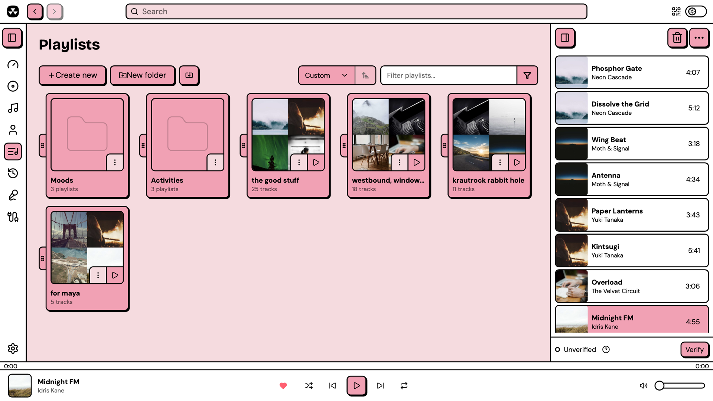
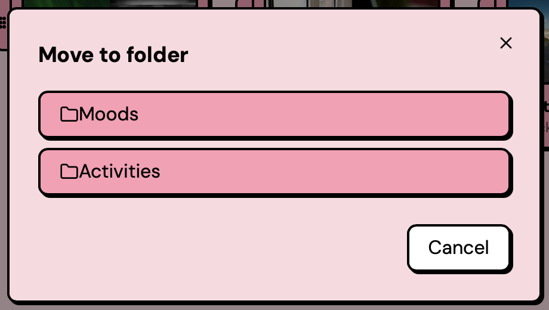
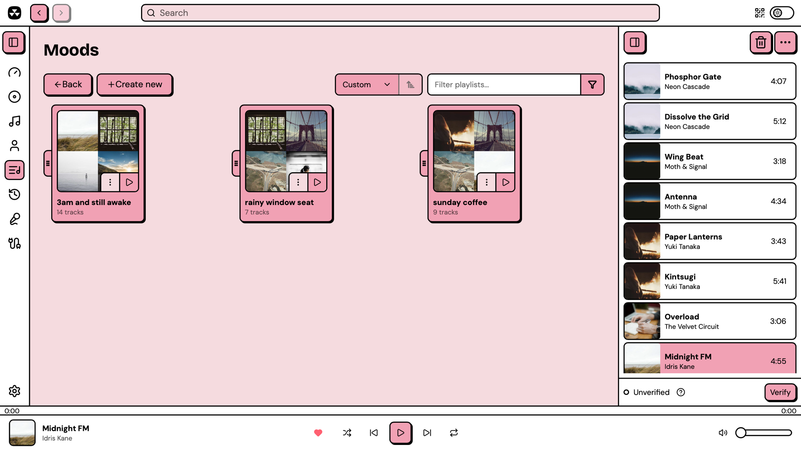
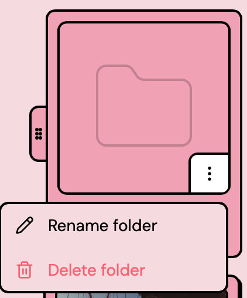

# Playlists

Playlists let you organize tracks into named collections. Open the **Playlists** view from the left sidebar to see all your playlists.

## Creating a playlist

Click **Create new** at the top of the Playlists view. Enter a name in the dialog and confirm. You can also save your current queue as a playlist from the queue header menu.

## Adding tracks

Use the three-dot menu (&#8942;) on any track and select **Add to playlist**, then pick the target playlist. The list includes the playlists in folders. If you have many playlists, a filter input at the top of the submenu lets you narrow them down.

## Folders

A folder is a group of playlists. A folder can contain playlists only. A folder cannot contain other folders.

<figure><figcaption>
Folders in the Playlists view
</figcaption></figure>

### Creating a folder

1. Click **New folder** at the top of the Playlists view.
2. Enter a name.
3. Click **Create new**.

The new folder shows at the end of the list. To move the folder to a different position, drag its handle.

### Moving a playlist into a folder

1. Open the three-dot menu (&#8942;) on the playlist card.
2. Select **Move to folder**.
3. Click the folder.

<figure><figcaption>
Selecting a folder for a playlist
</figcaption></figure>

The menu shows **Move to folder** only when there is a folder to move the playlist to. In a folder, you can use **Move to folder** to move a playlist directly to a different folder.

### Removing a playlist from a folder

1. Open the folder.
2. Open the three-dot menu (&#8942;) on the playlist card.
3. Select **Remove from folder**.

The playlist moves to the end of the top-level list.

### Opening a folder

Click the folder card. The view shows the playlists in the folder, and the title of the view is the name of the folder. To go back to all your playlists, click **Back**.

<figure><figcaption>
The playlists in a folder
</figcaption></figure>

In a folder, **Create new** creates the playlist in that folder. **New folder** and the import button are available only at the top level.

### Renaming or deleting a folder

1. Open the three-dot menu (&#8942;) on the folder card.
2. Select **Rename folder** or **Delete folder**.

<figure><figcaption>
The folder menu
</figcaption></figure>

Before Nuclear deletes a folder, it asks you to confirm. Nuclear does not delete the playlists in the folder. The playlists move to the position of the folder in the list.

### Sorting and filtering with folders

- **Custom** sort with an empty filter: you can drag folders and playlists at the top level. You can also drag the playlists in a folder.
- All other sort options: folders show first, sorted by name. Playlists show after the folders, sorted by the option that you select. The sort direction applies to folders and playlists.
- Filter at the top level: the filter searches all your playlists, also the playlists in folders. The results show playlists only, without folders.
- Filter in a folder: the filter searches only the playlists in that folder.

## Editing a playlist

In the playlist detail view, click the **pencil button** in the top-right corner to enter edit mode. You can change the playlist's name and description, then click **Save** to confirm or **Cancel** to discard changes.

## Playlist detail view

Click a playlist card to open it. The detail view shows the tracklist with the same controls as other track tables (+ button, three-dot menu, favorite toggle). From here you can:

- **Play** all tracks or **Add to queue** via the action buttons at the top
- **Reorder** tracks by dragging them
- **Remove** individual tracks with the delete button on each row
- **Export as JSON** from the three-dot action menu
- **Delete** the playlist from the three-dot action menu (asks for confirmation). If the playlist was in a folder, the view goes back to that folder.

<figure><figcaption>
The playlist detail view
</figcaption></figure>

## Importing playlists

Click the import button (next to **New folder**) to see two options:

- **Import from JSON**: opens a file picker. Nuclear accepts its own JSON export format as well as some legacy formats.
- **Import from URL**: opens a dialog where you paste a URL. Nuclear checks all installed playlists providers to find one that can handle it. If a match is found, you're taken to a preview page where you can save the playlist locally.

Playlists imported from a URL are **read-only**. You can play their tracks and add them to the queue, but you can't reorder or remove tracks.

## Persistence

Playlists and folders save to disk automatically and persist across restarts.
