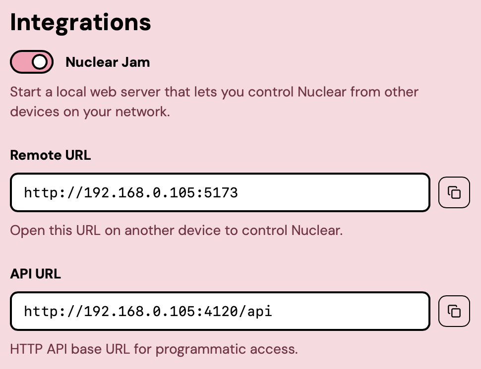
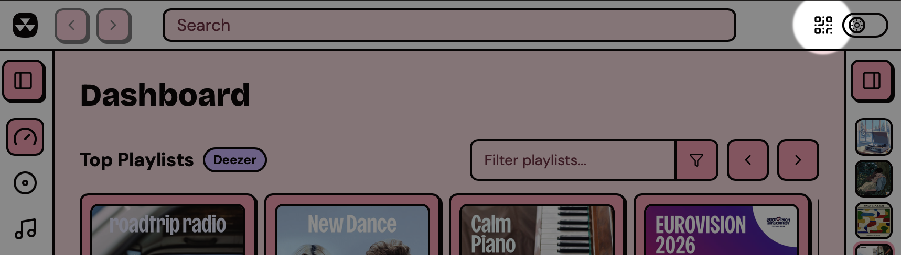
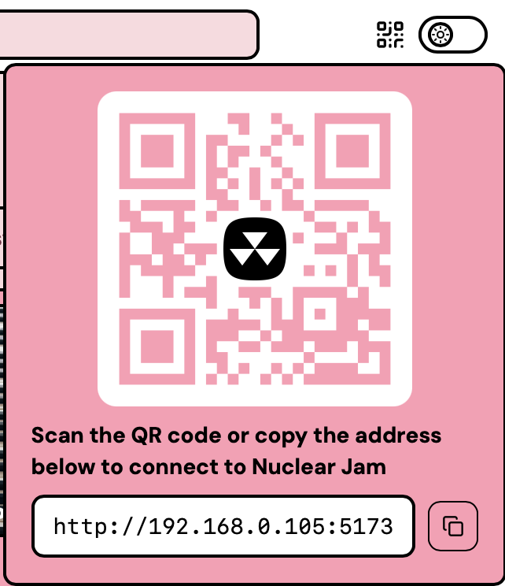
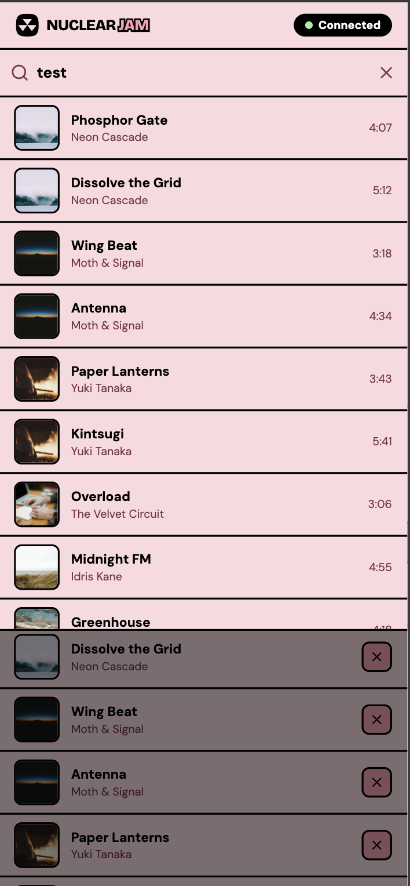
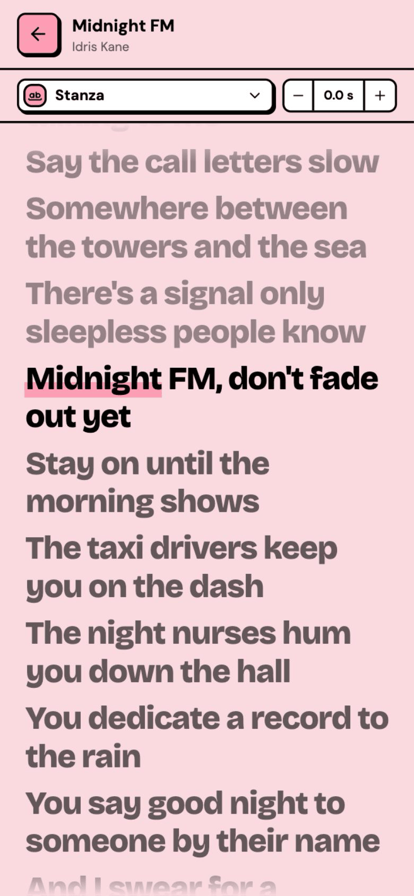
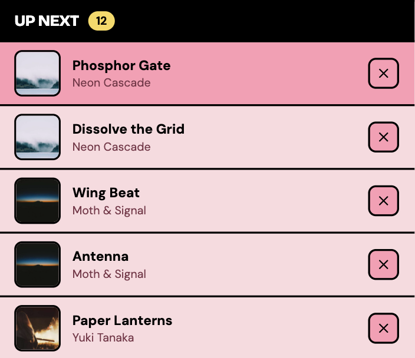

# Remote control

Nuclear Jam turns any device with a web browser into a remote for Nuclear. Pull out your phone, scan a QR code, and you can control playback and see the queue. Handy for parties, cooking, your housemates, and so on.

How does it work? Nuclear can start a small web server that can be accessed on your local network. Your phone (or other devices) connects to your computer directly - no data ever leaves your grasp.

## Enable Nuclear Jam

1. Open Nuclear, then go to Settings, then Integrations.
2. Toggle **Nuclear Jam** on.
3. Two read-only fields appear below the toggle: **Remote URL** and **API URL**. The Remote URL is what you open in a browser to use the remote. The API URL is for scripts and other integrations. See [HTTP API](../integrations/http-api.md) if you want to use it. Intended for programmers.

<figure><figcaption>
Enabling Nuclear Jam in Settings
</figcaption></figure>

The server binds to your LAN address on a port in the 4120-4129 range. If your computer's address is `192.168.1.42`, the Remote URL looks like `http://192.168.1.42:4120`.


Nuclear Jam only listens on your local network. Devices need to be on the same Wi-Fi (or wired LAN) to connect.


## Connect from your phone

Once Jam is on, a small QR code icon appears in the top bar of Nuclear, next to the theme switcher.

<figure><figcaption>
The QR code button in the top bar
</figcaption></figure>

Click it to open a popover with the QR code and the Remote URL.

<figure><figcaption>
The QR code popover
</figcaption></figure>

Scan the QR with your phone's camera, or just type the Remote URL into a browser on any device on the same network to load Nuclear Jam.

## What the remote does

The main screen of the remote has four sections: a search bar in the header, now playing, controls, and the queue. Lyrics have a page of their own.

<figure><figcaption>
Nuclear Jam on a phone
</figcaption></figure>

- **Now playing** at the top, with cover art, track title, and artist. The microphone button next to the title opens the lyrics page.
- **Controls** in the middle: previous, play/pause, next, plus a seek bar, shuffle, repeat, and discovery toggle.
- **Up next** at the bottom shows the queue, with the currently playing track highlighted. The number next to the heading is the number of tracks in the queue. Each item has an X button to remove it from the queue.

A badge in the header shows the connection status: **Connecting**, **Connected**, **Reconnecting**, or **Disconnected**.

Anything you do on the remote happens in Nuclear immediately, and vice versa: skipping a track on the desktop updates every connected remote. Multiple devices can connect at the same time and they all stay in sync.

### Searching for music

Use the search bar at the top to enter your query. A drawer will slide down with matching tracks.

<figure><figcaption>
Searching for tracks from the remote
</figcaption></figure>

Click (or tap) a track to add it to the queue. The drawer will close after adding. If the queue was empty, playback starts automatically.

### Lyrics

To open the lyrics page, tap the microphone button next to the title of the current track. The lyrics fill the screen. To go back to the main screen, tap the back arrow at the top of the page, or use the back button of your phone.

<figure><figcaption>
Lyrics on the remote
</figcaption></figure>

The remote gets the lyrics from the lyrics plugins in Nuclear, so you must install at least one lyrics plugin in Nuclear. The lyrics page works like the Lyrics view in Nuclear. It shows the same types of lyrics, and you can tap a line to jump to it, switch to a different source, and fix the timing of synced lyrics. For more information, see [Lyrics](../core-concepts/lyrics.md).

The lyrics page is different from the Lyrics view in these ways:

- The source and the timing that you choose apply only to the remote that you use. They don't change the lyrics in Nuclear or on other remotes.
- The page always scrolls to the current line. It has no auto-scroll switch.
- The page uses the text size that you set in the Lyrics view of Nuclear. It has no text size buttons.
- If no lyrics plugin is installed in Nuclear, the page shows **No lyrics for this track**.
- If the remote can't get the lyrics from Nuclear, the page shows **Could not load lyrics**. Check the connection to Nuclear and try again.

### Removing tracks from the queue

Each queue item shows an X button on the right side. Tap it to remove that track from the queue.

<figure><figcaption>
Removing a track from the queue
</figcaption></figure>
